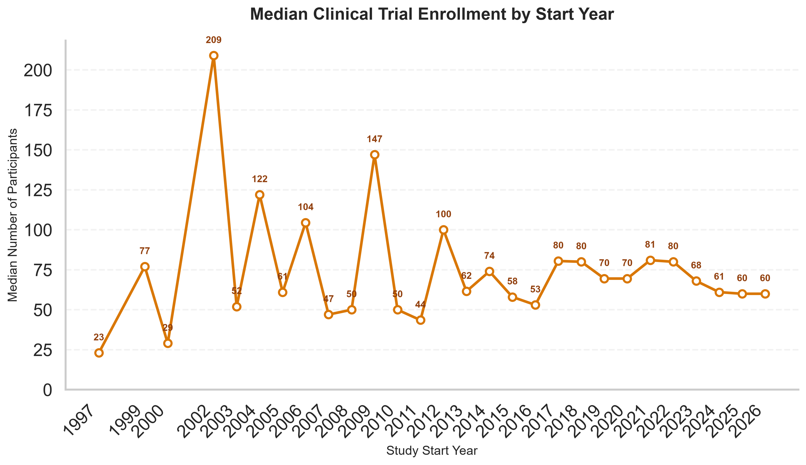

# Clinical Trial Landscape Analysis

### Exploring Clinical Trial Characteristics, Enrollment, and Funding Trends Using Python and Power BI

**Data Science Portfolio Project | DBE Academy | November 2026**


## Project Overview

This project explores clinical trial characteristics and research patterns using publicly available data retrieved from [ClinicalTrials.gov](https://clinicaltrials.gov/).

Developed as part of a certified **543-hour Data Science training programme at DBE Academy**, the project demonstrates the practical application of Python programming, API-based data extraction, data cleaning, exploratory data analysis, data visualization, and interactive dashboard development.

The analysis focuses on **5,000 completed interventional clinical studies**, examining:

- Drug versus non-drug intervention classifications
- Clinical trial funding sources
- Study phase distributions
- Medical conditions investigated
- Participant enrollment patterns
- Study start years and temporal distributions

The project combines computational data analysis with a biomedical research perspective to explore patterns in clinical trial datasets.

**Important:** Findings describe the selected sample of 5,000 studies and should not be generalized to the entire ClinicalTrials.gov registry.

---

## Project Objectives

The main objectives were to:

1. Retrieve structured clinical trial records using the ClinicalTrials.gov API.
2. Clean, transform, and validate clinical research data.
3. Explore drug and non-drug clinical trial classifications.
4. Investigate study phases and funding categories.
5. Identify frequently investigated medical conditions.
6. Examine participant enrollment distributions.
7. Explore study start-year patterns.
8. Develop an interactive Power BI dashboard to communicate analytical findings.

---

## Data Source and Sampling

**Source:** [ClinicalTrials.gov](https://clinicaltrials.gov/)

**Dataset:** 5,000 clinical trial records

**Unique study identifiers:** 5,000 NCT IDs

**Study selection:** Completed interventional studies

**Data acquisition:** ClinicalTrials.gov API

**Sampling approach:** Records were retrieved using API pagination and ordered by the most recent registry update date.

The dataset includes information on:

- NCT identifiers
- Study titles
- Recruitment status
- Medical conditions
- Interventions
- Study phases
- Participant enrollment
- Sponsors and funding classifications
- Study start and completion dates

Because the dataset consists of selected recently updated records, it should not be interpreted as a representative sample of the complete registry.

---

## Technologies and Tools

| Technology | Application |
|---|---|
| Python | API retrieval, data processing, and exploratory analysis |
| pandas | Data cleaning, manipulation, and transformation |
| Matplotlib | Statistical and exploratory visualizations |
| Power BI | Interactive dashboards and reporting |
| ClinicalTrials.gov API | Automated clinical trial data retrieval |
| Git and GitHub | Version control and project documentation |

---

## Analytical Workflow

### 1. Data Acquisition

Clinical trial records were retrieved programmatically through the ClinicalTrials.gov API.

The extraction workflow included API requests, pagination, structured field extraction, and removal of duplicate NCT identifiers.

**Script:** `fetch_clinical_trials.py`

### 2. Data Processing

The retrieved records were prepared for analysis through data cleaning and transformation.

The analytical workflow included:

- Inspecting dataset structure
- Checking missing values
- Reviewing duplicate identifiers
- Preparing study dates
- Deriving study start years
- Processing categorical variables
- Preparing enrollment data

**Script:** `process_clinical_trials.py`

### 3. Data Validation

Data validation was incorporated to assess dataset consistency and completeness.

**Script:** `validate_clinical_trials.py`

### 4. Exploratory Data Analysis

Exploratory analysis was performed to investigate study characteristics, funding categories, enrollment patterns, and temporal distributions.

**Script:** `explore_data.py`

### 5. Data Updates

A separate Python script supports the project's data update workflow.

**Script:** `update_clinical_trials.py`

### 6. Data Visualization and Reporting

Python visualizations were created to communicate analytical findings.

An interactive Power BI dashboard was also developed to present study characteristics and allow further exploration of the dataset.

---

## Interactive Power BI Dashboard


The dashboard provides an overview of clinical trial characteristics using interactive visualizations and filtering options.

### Dashboard Summary

| Indicator | Value |
|---|---:|
| Total clinical trials | 5,000 |
| Total reported enrollment | 2,624,083 |
| Median enrollment | 62 |

The total enrollment is the sum of reported study enrollment values, rather than a verified count of unique participants across studies.

### Dashboard Features

The dashboard includes:

- Clinical trial phase distribution
- Clinical trials by funding classification
- Frequently investigated medical conditions
- Median enrollment by study start year
- Clinical trials by start year
- Interactive study start-date filtering
- Interactive funding classification filtering

**Power BI File:** [Clinical_Trial_Analysis_5000.pbix](Clinical_Trial_Analysis_5000.pbix)

---

# Key Findings and Visualizations
The analysis examined 5,000 completed interventional clinical trials retrieved from ClinicalTrials.gov.

- **Enrollment:** The studies reported a combined enrollment of 2,425,863 participants, with a median enrollment of 62 participants per trial.
- **Study phases:** Phase information was not reported for 3,424 studies (68.5%). Among studies with reported phases, Phase 2 (436) and Phase 1 (351) were the most common categories.
- **Funding:** The OTHER funding category accounted for 3,723 studies (74.5%), followed by INDUSTRY with 996 studies (19.9%).
- **Study conditions:** Anxiety and obesity were among the most frequently reported conditions.
- **Temporal distribution:** Studies starting in 2025 were particularly prominent in the selected dataset.

**Interpretation:** The dataset comprises a selected sample of recently updated, completed interventional studies. Therefore, the observed distributions and temporal patterns should not be interpreted as representative of all clinical trials registered worldwide.
## 1. Drug vs. Non-Drug Clinical Trials


Among the 5,000 analyzed studies:

| Classification | Number | Percentage |
|---|---:|---:|
| Drug trials | 1,556 | 31.1% |
| Non-drug trials | 3,444 | 68.9% |
| **Total** | **5,000** | **100%** |

Non-drug trials represented the larger proportion of the analyzed dataset.

The classification reflects the project's intervention-based grouping and should not automatically be interpreted as a regulatory classification.

---

## 2. Clinical Trials by Funding Classification


The distribution of clinical trials across funding categories showed:

| Funding Type | Percentage |
|---|---:|
| OTHER | 74.5% |
| INDUSTRY | 19.7% |
| OTHER_GOV | 2.9% |
| NIH | 1.6% |
| FED | 0.7% |
| NETWORK | 0.5% |
| INDIV | Approximately 0.0% |

Percentages are rounded.

The OTHER classification accounted for the largest proportion of studies, followed by INDUSTRY.

These categories describe registry funding classifications rather than the financial amounts invested in individual studies.

---

## 3. Drug vs. Non-Drug Trials by Funding Category


The proportion of drug and non-drug studies varied across funding categories.

Industry-funded studies had a higher proportion of drug trials than several other funding classifications.

Non-drug studies predominated in a number of non-industry funding categories.

This comparison illustrates how intervention classifications differ across funding groups within the selected dataset.

---

## 4. Funding Categories by Study Start Year


The distribution of clinical trials across study start years showed a concentration of records in more recent years.

The OTHER funding classification accounted for the largest share across many study years.

Industry-funded studies also contributed to the observed distribution.

These patterns should be interpreted in the context of the dataset selection method rather than as evidence of registry-wide growth.

---

## 5. Clinical Trial Enrollment Distribution


Participant enrollment varied substantially across the analyzed studies.

The distribution was strongly right-skewed, with most trials reporting relatively modest enrollment and a small number reporting exceptionally large enrollment values.

A logarithmic scale was used to improve visualization across the wide enrollment range.

This demonstrates the importance of considering distributional characteristics when analyzing clinical research data.

---

## 6. Median Enrollment by Study Start Year



Median enrollment varied across study start years.

Earlier years showed larger fluctuations, while more recent years displayed comparatively stable median enrollment values.

For studies starting in 2025 and 2026, the plotted median enrollment was approximately 60 participants.

These observations should be interpreted cautiously because the number of sampled studies varies across years.

---

## 7. Distribution of Clinical Trials by Study Phase


The study phase distribution showed:

| Study Phase | Number of Trials |
|---|---:|
| Not Reported | 3,399 |
| Phase 2 | 448 |
| Phase 1 | 352 |
| Phase 3 | 333 |
| Phase 4 | 259 |
| Phase 1 / Phase 2 | 115 |
| Early Phase 1 | 56 |
| Phase 2 / Phase 3 | 38 |

Approximately 68.0% of the analyzed records had no reported study phase.

The absence of phase information does not necessarily indicate incomplete reporting, as phase classifications are not applicable to all types of interventional studies.

---

## 8. Most Frequent Conditions in Completed Clinical Trials


The most frequently represented condition labels included:

| Condition | Number of Trials |
|---|---:|
| Anxiety | 85 |
| Obesity | 74 |
| Healthy | 72 |
| Stroke | 61 |
| Depression | 50 |
| Postoperative Pain | 50 |
| Pain | 43 |
| Breast Cancer | 40 |
| Healthy Volunteers | 39 |
| Hypertension | 38 |

Anxiety and obesity were among the most frequently reported condition labels in the analyzed sample.

Because individual trials may report multiple conditions, these counts are not mutually exclusive.

---

## 9. Clinical Trials by Study Start Year


The distribution of clinical trials by study start year showed a concentration of records with recent start dates.

The highest number of sampled studies occurred in 2025, followed by a lower count for 2026.

This pattern reflects the temporal composition of the selected records and may be influenced by the registry update-based sampling strategy.

It should not be interpreted as a measure of overall clinical trial growth.

---

## Data Quality Assessment

Data quality assessment formed an important component of the analytical workflow.

The analysis included:

- Examination of missing values
- Verification of unique NCT identifiers
- Review of study phase completeness
- Assessment of enrollment information
- Inspection of categorical variables
- Preparation of date fields for analysis

The dataset contained 5,000 unique NCT identifiers across 5,000 records.

Missing or non-applicable values were observed in several variables, including study phases, collaborators, and posted study results.

These observations highlight the importance of considering registry reporting requirements and study characteristics when interpreting clinical trial datasets.

---

## Repository Structure

```text
clinical-trial-landscape-analysis/
│
├── README.md
├── LICENSE
├── requirements.txt
│
├── Clinical_Trial_Analysis_5000.pbix
│
├── fetch_clinical_trials.py
├── process_clinical_trials.py
├── validate_clinical_trials.py
├── explore_data.py
├── update_clinical_trials.py
│
└── figures/
    ├── Power BI dashboard.png
    ├── Drug vs non-drug.png
    ├── Drug trials by funding category.png
    ├── Enrollment distribution.png
    ├── Funding classification.png
    ├── Funding over time.png
    ├── Intervention.png
    ├── Median_enrollment.png
    ├── Most frequent condition in completed trials.png
    ├── Study phases.png
    ├── clinical trials by year.png
    └── README.md
```

The additional `Intervention.png` file is retained in the figures directory but is not included in the analytical findings above.

---

## Getting Started

### 1. Clone the Repository

```bash
git clone https://github.com/kwakuanim/clinical-trial-landscape-analysis.git

cd clinical-trial-landscape-analysis
```

### 2. Install Python Dependencies

```bash
python -m pip install -r requirements.txt
```

### 3. Retrieve Clinical Trial Data

```bash
python fetch_clinical_trials.py
```

The retrieval script obtains clinical trial records through the ClinicalTrials.gov API.

The complete execution order of the remaining analysis scripts has not yet been independently tested on a fresh installation.

### 4. Explore the Power BI Dashboard

Open the following file using Microsoft Power BI Desktop:

`Clinical_Trial_Analysis_5000.pbix`

---

## Project Limitations

The analysis has several limitations:

1. **Sampling:** The dataset represents selected recently updated completed interventional studies rather than the entire ClinicalTrials.gov registry.
2. **Data completeness:** Certain variables contain missing or non-applicable values.
3. **Enrollment:** Reported enrollment may include actual or estimated participant counts.
4. **Temporal interpretation:** Study start-year patterns may be influenced by the sampling approach.
5. **Classification:** Drug and non-drug categories follow the project's analytical classification method.
6. **Causality:** The findings are descriptive and do not establish causal relationships.

---

## Future Improvements

Potential extensions include:

- Expanding the clinical trial dataset.
- Implementing automated data refresh workflows.
- Improving documentation of the complete analytical pipeline.
- Introducing automated data validation tests.
- Expanding Power BI filtering and analytical capabilities.
- Investigating clinical trial characteristics across therapeutic areas.
- Exploring advanced statistical and predictive analytical methods.

---

## Author

**Manfred Anim, PhD**

Molecular Medicine | Translational Immunology | Genomics | Data Science

**GitHub:** [kwakuanim](https://github.com/kwakuanim)

**Professional Interests:**

Biomedical Data Science, Bioinformatics, Clinical Research Analytics, Translational Medicine, and Precision Medicine.

---

## Acknowledgment

This project was developed as part of the certified **Data Scientist training programme at DBE Academy (2026)**.

The programme comprised 543 teaching hours covering Python, R, database technologies, artificial intelligence, machine learning, data visualization, cloud computing, and practical project development.

---

## Data Attribution

Clinical trial information was obtained from [ClinicalTrials.gov](https://clinicaltrials.gov/), maintained by the U.S. National Library of Medicine.

This project is intended for educational, research, and professional portfolio purposes.
